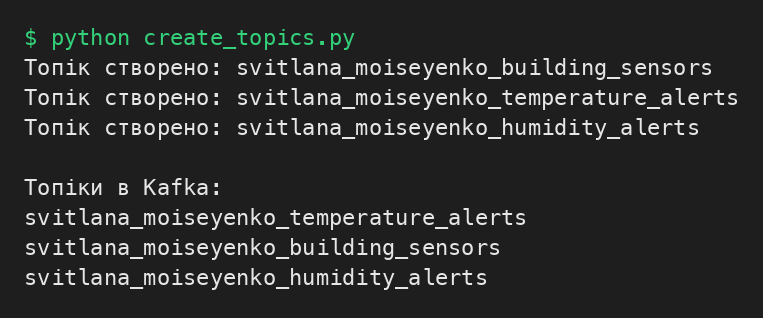
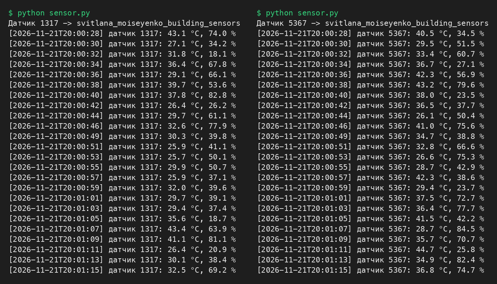
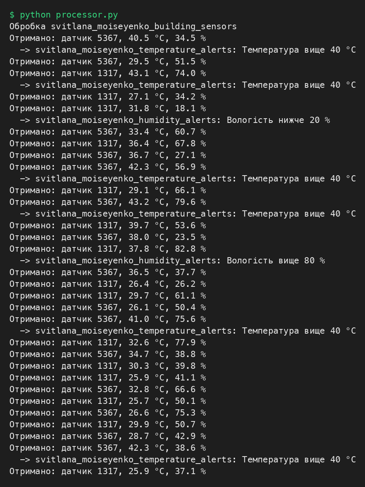
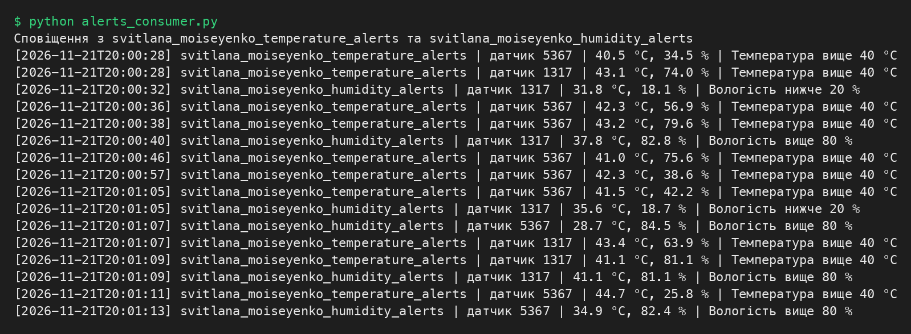

# ДЗ 5. Apache Kafka

Система моніторингу IoT-датчиків: датчики пишуть показники в Kafka, обробник фільтрує їх і формує сповіщення, читач сповіщень виводить їх на екран.

## Структура

| Файл | Призначення |
|---|---|
| `configs.py` | Налаштування підключення, імена топіків, фабрики продюсера та консьюмера |
| `create_topics.py` | Етап 1: створення трьох топіків |
| `sensor.py` | Етап 2: імітація одного датчика (один запуск = один датчик) |
| `processor.py` | Етапи 3–4: читання `building_sensors`, фільтрація, відправка сповіщень |
| `alerts_consumer.py` | Етап 5: читання `temperature_alerts` і `humidity_alerts`, вивід на екран |
| `docker-compose.yaml` | Локальний брокер Kafka |

## Запуск

```bash
docker compose up -d
pip install -r requirements.txt

python create_topics.py
python processor.py          # термінал 1
python alerts_consumer.py    # термінал 2
python sensor.py             # термінал 3
python sensor.py             # термінал 4
```

Для іншого брокера задайте `KAFKA_BOOTSTRAP_SERVERS`, `KAFKA_SECURITY_PROTOCOL` (наприклад, `SASL_PLAINTEXT`), `KAFKA_USERNAME`, `KAFKA_PASSWORD`.

## Результати

Зображення нижче — вивід реального запуску скриптів на локальному брокері.

### 1. Створення трьох топіків

Імена топіків мають префікс `svitlana_moiseyenko`.



### 2. Генерація даних та відправка в `building_sensors`

Два одночасні запуски `sensor.py` — датчики 1317 і 5367. Температура 25–45 °C, вологість 15–85 %, повідомлення кожні 2 с.



### 3–4. Отримання, фільтрація та відправка сповіщень

`processor.py` читає кожне повідомлення; рядки `->` показують, у який топік надіслано сповіщення:

- температура > 40 °C → `temperature_alerts`;
- вологість > 80 % або < 20 % → `humidity_alerts`.



### 5. Читання сповіщень

`alerts_consumer.py` виводить сповіщення з обох топіків: час, топік, ID датчика, показники та повідомлення про поріг.



## Висновки

- За 48 показників від двох датчиків сформовано 16 сповіщень: 10 температурних і 6 щодо вологості.
- Одне повідомлення може породити два сповіщення (датчик 1317: 41.1 °C і 81.1 %).
- Усі сповіщення, надіслані обробником, отримано читачем без втрат.
