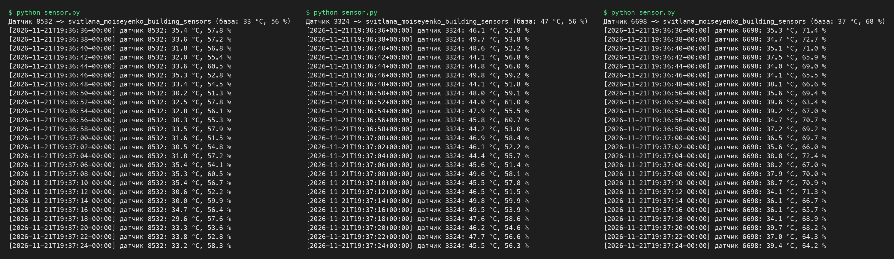
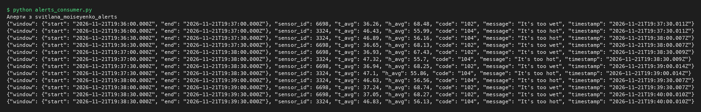

# ДЗ 6. Spark Streaming

Моніторинг IoT-датчиків: датчики пишуть показники в Kafka, Spark Structured Streaming рахує середні значення у ковзному вікні, порівнює їх з умовами з `alerts_conditions.csv` і записує алерти у вихідний топік Kafka.

## Структура

| Файл | Призначення |
|---|---|
| `configs.py` | Налаштування підключення, імена топіків, фабрики продюсера та консьюмера |
| `create_topics.py` | Створення топіків `building_sensors` та `alerts` |
| `sensor.py` | Етап 1: імітація одного датчика (один запуск = один датчик) |
| `spark_streaming.py` | Етапи 2–5: агрегація, умови алертів, cross join з фільтрацією, запис у Kafka |
| `alerts_conditions.csv` | Етап 3: параметри алертів |
| `alerts_consumer.py` | Читання топіку алертів і вивід на екран |
| `docker-compose.yaml` | Локальний брокер Kafka та контейнер зі Spark |

## Як це працює

1. **Генерація даних.** `sensor.py` кожні 2 с надсилає в `svitlana_moiseyenko_building_sensors` повідомлення з полями `sensor_id`, `temperature`, `humidity`, `timestamp`. Кожен датчик має власний базовий рівень температури й вологості, навколо якого коливаються показники, тому середні значення різних датчиків відрізняються.
2. **Агрегація.** Spark читає топік і рахує середні `t_avg` та `h_avg` для кожного датчика у sliding window: довжина 1 хвилина, sliding interval 30 секунд, watermark 10 секунд.
3. **Параметри алертів** зчитуються з `alerts_conditions.csv`. Значення `-999` означає, що межа не використовується.
4. **Визначення алертів.** Середні значення з'єднуються з умовами через cross join; лишаються рядки, де `t_avg` та `h_avg` потрапляють у межі умови.
5. **Запис у Kafka.** Алерти у форматі JSON надсилаються в `svitlana_moiseyenko_alerts`. Режим виводу `append`: алерт для вікна надсилається один раз, коли watermark пройшов кінець вікна.

## Запуск

```bash
docker compose up -d kafka
pip install kafka-python==2.0.2

python create_topics.py
docker compose up -d spark   # spark_streaming.py у контейнері
python alerts_consumer.py    # термінал 1
python sensor.py             # термінал 2
python sensor.py             # термінал 3
python sensor.py             # термінал 4
```

Без Docker Spark-задачу можна запустити локально (потрібна Java):

```bash
spark-submit --packages org.apache.spark:spark-sql-kafka-0-10_2.12:3.5.3 spark_streaming.py
```

## Результати

Зображення нижче — вивід реального запуску скриптів на локальному брокері.

### 1. Генерація даних сенсорів та відправка в `building_sensors`

Три одночасні запуски `sensor.py` — датчики 8532, 3324 і 6698.



### 2. Алерти у вихідному топіку

`alerts_consumer.py` читає `svitlana_moiseyenko_alerts`, куди Spark записав відфільтровані дані: вікно, датчик, середні значення, код і повідомлення алерту, час формування.



## Висновки

- Датчик 3324 (середня температура ≈ 47 °C) у кожному вікні отримує алерт `104 It's too hot`, датчик 6698 (середня вологість ≈ 68 %) — `102 It's too wet`.
- Датчик 8532 (≈ 33 °C, ≈ 56 %) перебуває в межах норми, тому алертів для нього немає.
- За шість послідовних вікон сформовано 12 алертів — по одному на датчик і вікно; нові вікна з'являються кожні 30 секунд.
