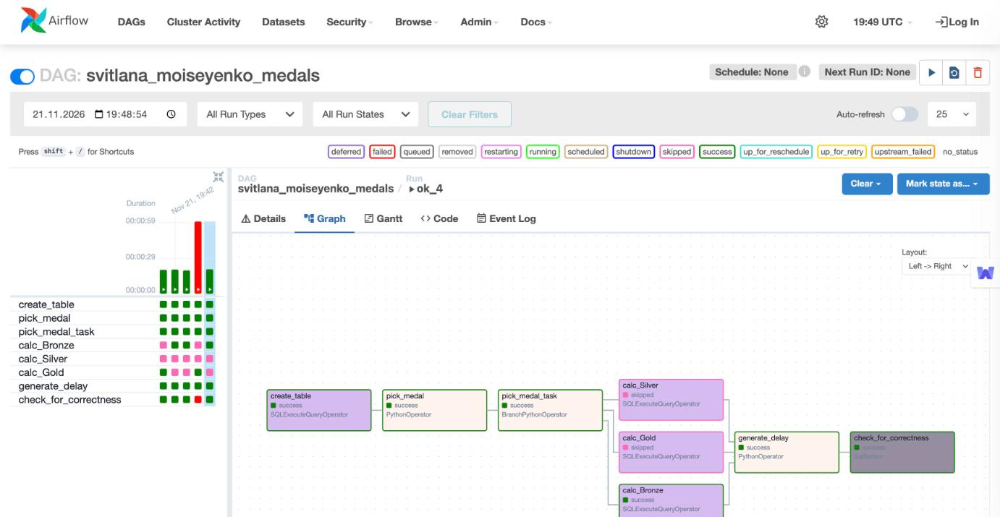
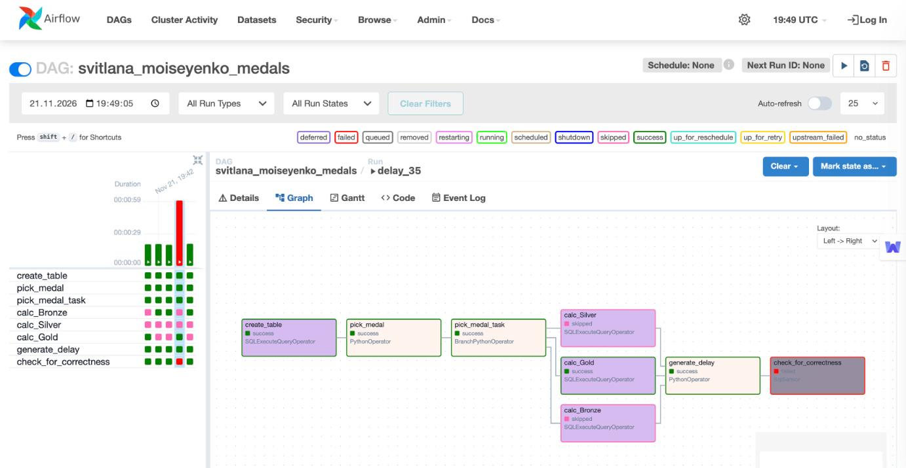
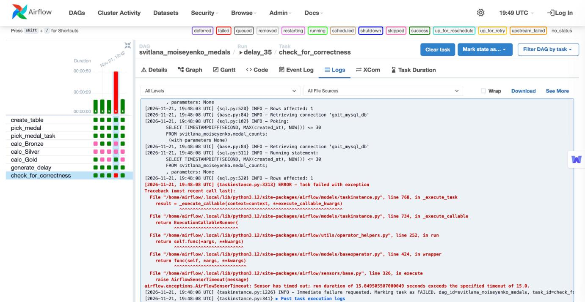
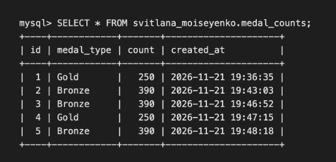

# ДЗ 7. Apache Airflow

DAG `svitlana_moiseyenko_medals`: випадково обирає тип медалі, рахує кількість відповідних записів у `olympic_dataset.athlete_event_results`, записує результат у MySQL і сенсором перевіряє, що запис свіжий.

## Структура

| Файл | Призначення |
|---|---|
| `dags/medals_dag.py` | DAG із шістьма етапами завдання |
| `docker-compose.yaml` | Локальний стенд: Airflow 2.10 і MySQL 8.4 |
| `mysql-init/init.sql` | Схеми та тестова вибірка `athlete_event_results` |
| `webserver_config.py` | Вхід в Airflow UI без пароля (лише для локального стенда) |

## Завдання DAG

| № | Task | Оператор | Що робить |
|---|---|---|---|
| 1 | `create_table` | `SQLExecuteQueryOperator` | `CREATE TABLE IF NOT EXISTS svitlana_moiseyenko.medal_counts` з полями `id` (автоінкремент, PK), `medal_type`, `count`, `created_at` |
| 2 | `pick_medal` | `PythonOperator` | Випадково обирає `Bronze`, `Silver` або `Gold`; значення йде в XCom |
| 3 | `pick_medal_task` | `BranchPythonOperator` | Читає значення з XCom і запускає `calc_<medal>` |
| 4 | `calc_Bronze`, `calc_Silver`, `calc_Gold` | `SQLExecuteQueryOperator` | Рахує записи з відповідним значенням у полі `medal` і вставляє тип медалі, кількість і час у `medal_counts` |
| 5 | `generate_delay` | `PythonOperator` | `time.sleep(n)`; `trigger_rule=one_success` — запускається, якщо одне з трьох завдань успішне |
| 6 | `check_for_correctness` | `SqlSensor` | Перевіряє, що найновіший запис не старший за 30 с; інакше падає через 15 с |

Затримка задається параметром `delay_seconds` (типово 10 с).

## Запуск

```bash
docker compose up -d          # Airflow UI: http://localhost:8080

# успішний запуск (затримка 10 с)
docker exec airflow-hw-07 airflow dags trigger svitlana_moiseyenko_medals

# затримка 35 с — сенсор падає
docker exec airflow-hw-07 airflow dags trigger svitlana_moiseyenko_medals -c '{"delay_seconds": 35}'
```

З'єднання з MySQL — `goit_mysql_db`. Щоб запустити DAG на навчальному сервері, достатньо створити там з'єднання з таким самим ID.

## Результати

Зображення нижче — реальні запуски DAG на локальному стенді. Таблиця `olympic_dataset.athlete_event_results` тут — згенерована тестова вибірка з 5000 рядків (250 Gold, 361 Silver, 390 Bronze), тому числа відрізняються від навчальної бази.

### 1. Успішний запуск

Обрано `Bronze`: виконано `calc_Bronze`, дві інші гілки пропущено (skipped). Затримка 10 с, сенсор пройшов.



### 2. Запуск із затримкою 35 с — сенсор падає

Обрано `Gold`, запис у таблицю зроблено, але після 35 с затримки він старший за 30 с — `check_for_correctness` завершується зі статусом failed. У сітці ліворуч видно всі п'ять запусків: чотири успішні й один невдалий.



### 3. Лог сенсора

Сенсор чотири рази виконав запит і завершився з `AirflowSensorTimeout`.



### 4. Таблиця з даними

П'ять запусків — п'ять записів. Запис `id = 4` створено запуском із затримкою 35 с.



## Висновки

- Розгалуження щоразу запускає рівно одне з трьох завдань підрахунку; інші два отримують статус skipped.
- `trigger_rule=one_success` потрібен, бо зі стандартним правилом `all_success` завдання затримки було б пропущено разом зі skipped-гілками.
- Сенсор порівнює `MAX(created_at)` з `NOW()` на боці MySQL, тож різниця часових поясів Airflow і бази на результат не впливає.
- У п'яти запусках випадково випали лише `Gold` і `Bronze`; гілка `calc_Silver` у цих запусках не виконувалась.
